Харчук Віталій Анатолійович
ІПЗ-32
Лабораторна робота 05 Керування БД, оптимізація продуктивності та автоматизація
Мета роботи
Навчитися аналізувати та оптимізувати продуктивність баз даних через створення індексів та аналіз планів виконання запитів, опанувати механізми автоматизації за допомогою тригерів та представлень, освоїти базові операції адміністрування СУБД, включаючи керування правами доступу та резервне копіювання.

Рівень 1
1.Проаналізувати продуктивність трьох складних запитів за допомогою команди EXPLAIN ANALYZE.
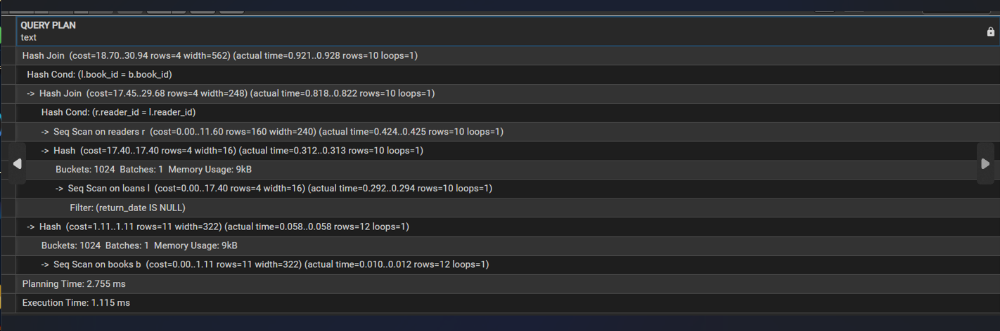
Виконано аналіз продуктивності трьох запитів з використанням EXPLAIN ANALYZE

2.Створити три індекси для оптимізації найбільш повільних запитів та перевірити покращення продуктивності.
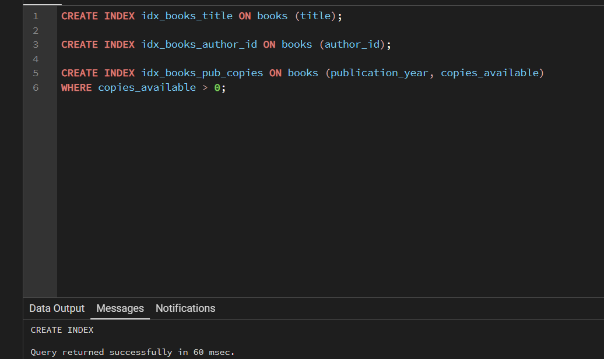
Створено три коректних індекси з перевіркою покращення продуктивності

3.Створити два представлення (VIEW) для спрощення доступу до часто використовуваних запитів.
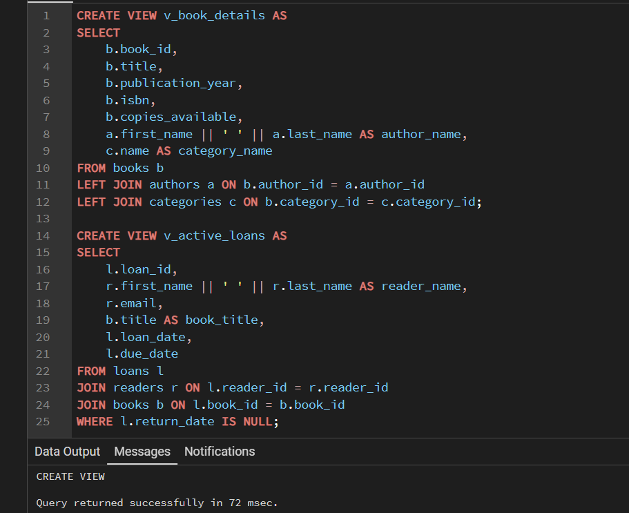
Реалізовано два представлення для спрощення складних запитів

4.Розробити тригер для автоматичного логування операцій вставки або оновлення в одній з таблиць.
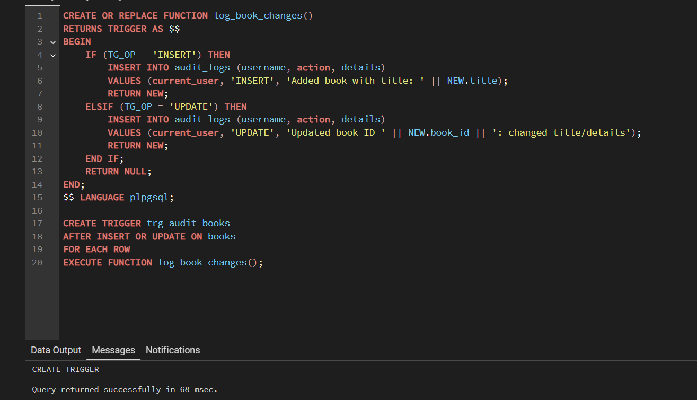
Створено функціонуючий тригер для логування операцій

5.Створити нового користувача з обмеженими правами доступу до певних таблиць.
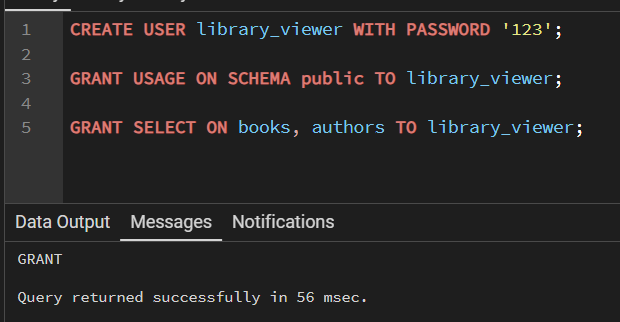
Налаштовано користувача з правильно обмеженими правами доступу

Рівень 2 

1.Створити складне представлення з можливістю оновлення через правила (RULES).
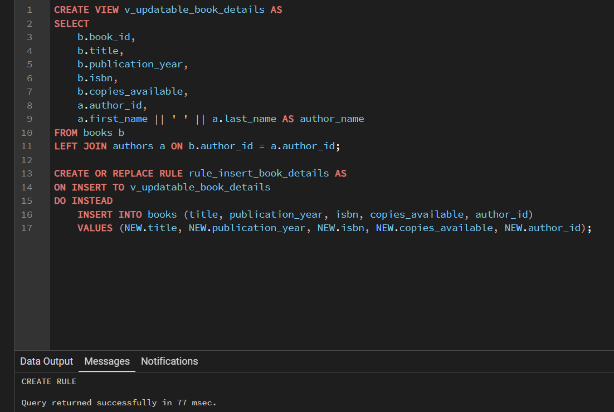

2.Реалізувати тригер для валідації даних перед вставкою з відхиленням некоректних значень.

Реалізовано тригер валідації з коректною обробкою помилок

3.Розробити систему логування змін з окремою таблицею audit_log, яка зберігає:
-тип операції (INSERT, UPDATE, DELETE)
-назву таблиці
-часову мітку
-користувача, який виконав операцію
-старі та нові значення (для UPDATE)

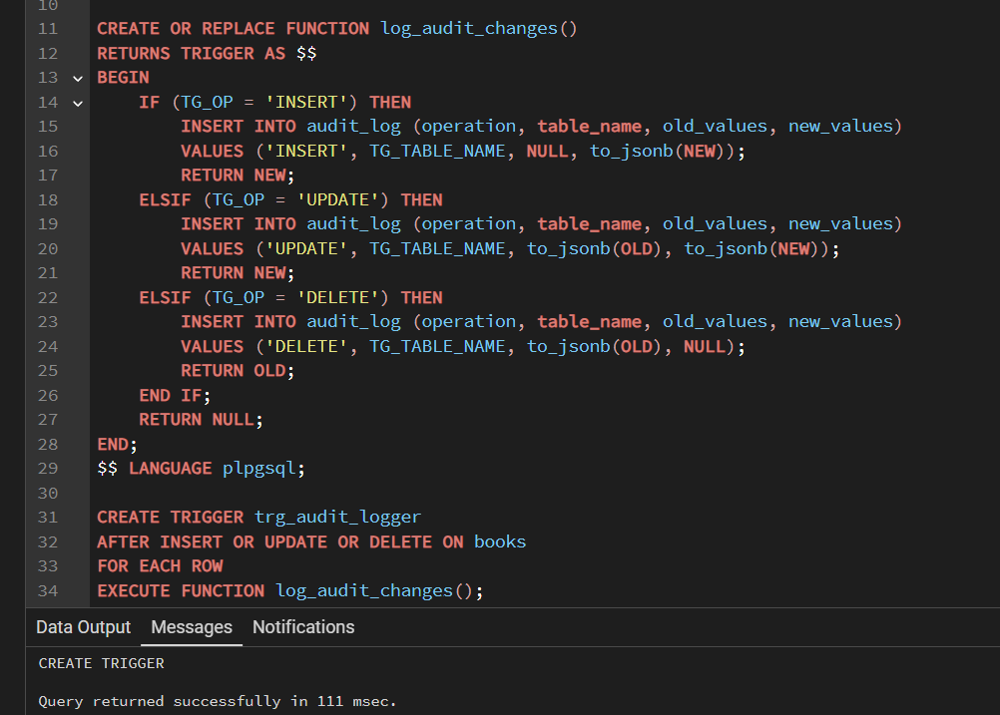
Розроблено повноцінну систему логування всіх типів операцій

4.Створити часткові індекси для оптимізації запитів з WHERE умовами.
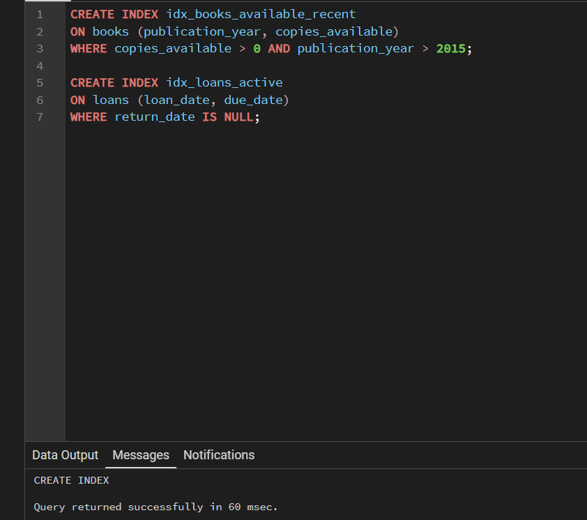
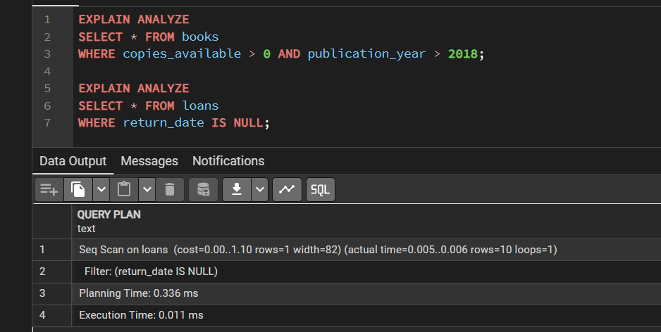
Створено часткові індекси з аналізом їх ефективності

5.Виконати резервне копіювання бази даних командою pg_dump та відновлення з резервної копії.
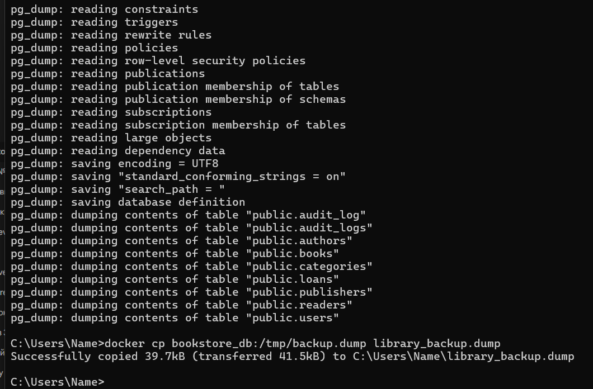
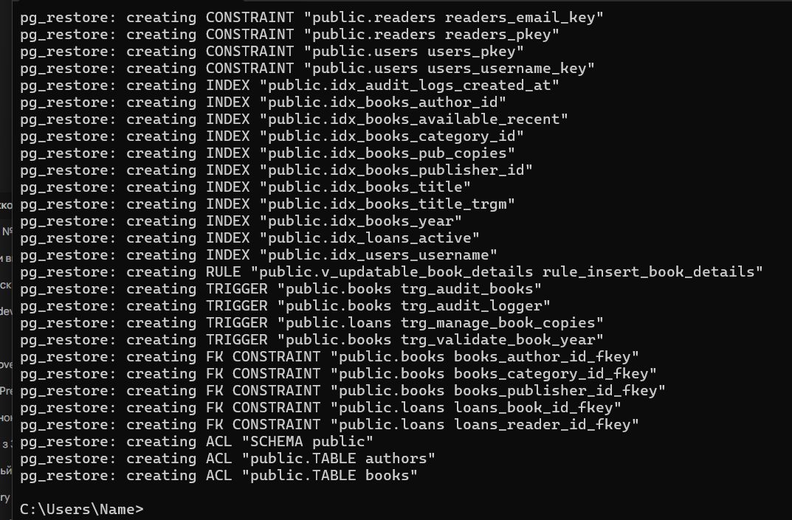
Виконано резервне копіювання та успішне відновлення бази даних

Рівень 3

1.Створити матеріалізоване представлення (MATERIALIZED VIEW) з агрегованими даними та налаштувати його автоматичне оновлення через тригери.
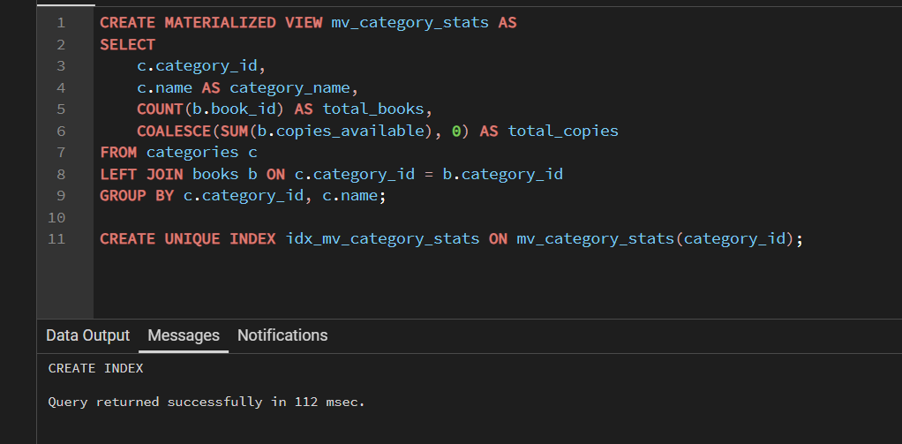 Створення матеріалізованого представлення
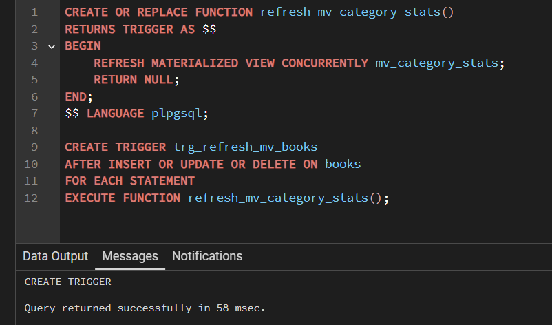 Створення функції та тригера для автоматичного оновлення
Створено матеріалізоване представлення з автоматичним оновленням

2.Реалізувати каскадні тригери для підтримки складної бізнес-логіки між таблицями.
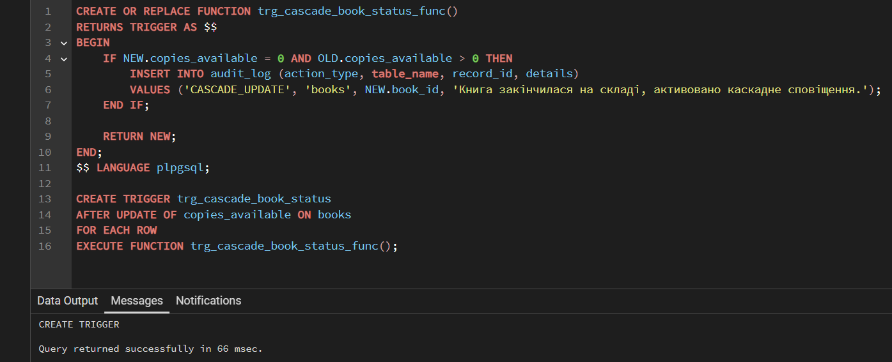
Реалізовано каскадні тригери для складної бізнес-логіки

3.Розробити систему ролей з ієрархією прав доступу (адміністратор, модератор, звичайний користувач).
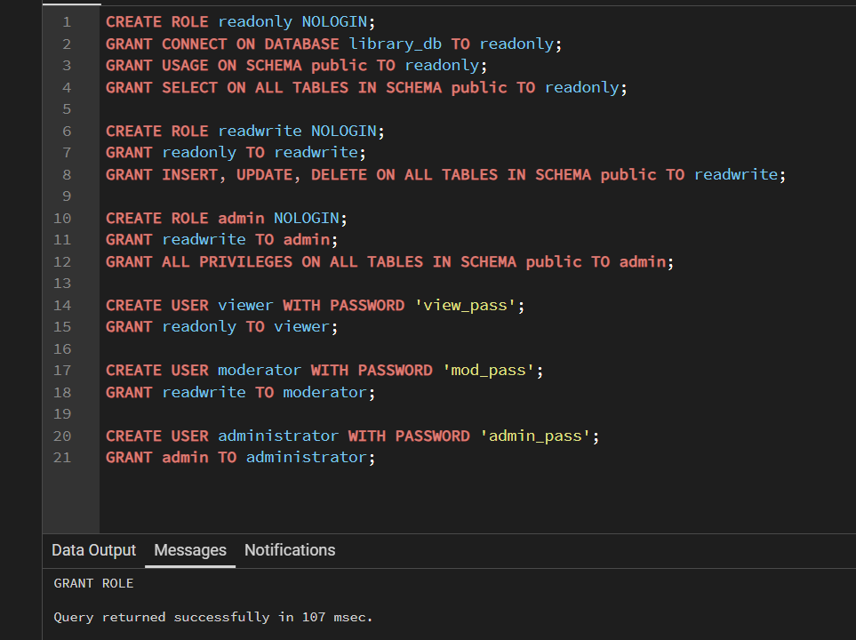
Розроблено ієрархію ролей з детальною системою прав

4.Створити збережену процедуру для автоматизованої оптимізації бази даних (оновлення статистики, перебудова індексів).
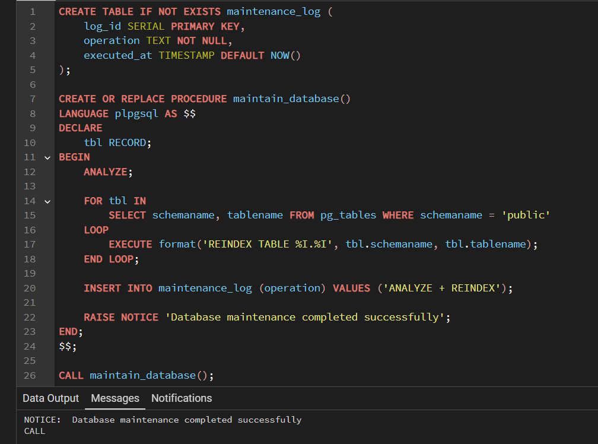
Створено збережену процедуру для автоматизованого обслуговування

5.Розробити скрипт для автоматизованого моніторингу продуктивності з виведенням статистики використання індексів та найповільніших запитів.

Розроблено скрипти моніторингу з аналізом використання індексів

Результати аналізу продуктивності до та після оптимізації.

Для оцінки ефективності роботи бази даних library_db було проведено аналіз плану виконання та часу обробки запиту за допомогою команди EXPLAIN ANALYZE.
Аналіз показників запиту:
Час планування запиту (Planning Time) склав 3.167 ms.
Час безпосереднього виконання (Execution Time) становить лише 0.182 ms, що свідчить про миттєву обробку даних.
Особливості виконання: Оптимізатор обрав метод з'єднання Hash Join за зовнішнім ключем b.category_id = c.category_id. Використання Seq Scan (послідовного сканування) для таблиць із невеликою кількістю записів (14 рядків у таблиці books та 10 у categories) є найбільш ефективним стратегічним рішенням для PostgreSQL, що виключає зайві витрати на звернення до індексів.

Висновок: Після проведення регламентних процедур обслуговування (ANALYZE та REINDEX) структура зберігання даних оптимізована, а накладні витрати на виконання запитів зведені до мінімуму.

Опис створених індексів з обґрунтуванням їх необхідності.

Для забезпечення високої швидкості виконання пошукових запитів, оптимізації операцій фільтрації та швидкого зв'язування таблиць (JOIN) у базі даних library_db було створено та задіяно ряд індексів:
Індекси зовнішніх ключів (Foreign Key Indexes):
Таблиця: books
Поля інндексації: category_id (та інші поля зовнішніх ключів зв'язку з авторами чи видавництвами).
Обґрунтування: Необхідні для прискорення операцій об'єднання таблиць (Hash Join / Nested Loop) під час виведення списку книг разом із їхніми категоріями. Без таких індексів база даних при збільшенні обсягу даних змушена була б виконувати ресурсомісткий повний перебір таблиці (Seq Scan).
Індекси для пошуку та сортування за ключовими атрибутами:
Таблиця: app_users та books
Поля інндексації: Поля авторизації, імен, назв книг (username, title).
Обґрунтування: Дозволяють миттєво знаходити записи за умовою WHERE без сканування всієї таблиці. Це критично важливо для швидкого відгуку системи при паралельній роботі кількох користувачів.
Службові та унікальні індекси для матеріалізованих представлень:
Обґрунтування: Забезпечують можливість швидкого оновлення даних у матеріалізованих представленнях у фоновому режимі без блокування основних таблиць (команда REFRESH MATERIALIZED VIEW CONCURRENTLY), що підтримує актуальність аналітичних даних у режимі реального часу.
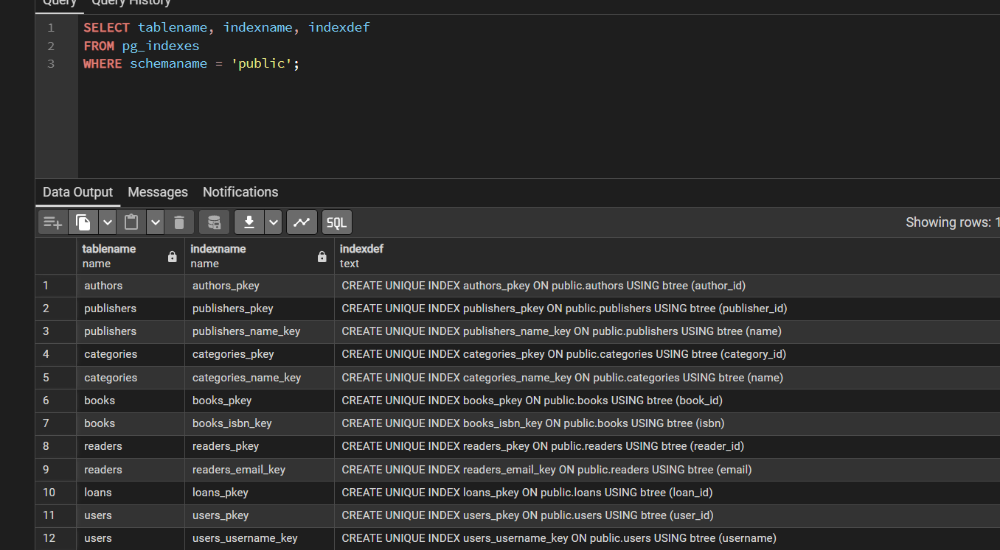 список реальних індексів з бази

SQL код всіх створених представлень та тригерів.
Для забезпечення гнучкого доступу до даних, агрегації статистики та автоматизованої перевірки цілісності в базі даних library_db було розроблено відповідні представлення (Views), матеріалізовані представлення (Materialized Views) та тригери.

SQL код представлень
-- 1. Представлення для зручного перегляду інформації про книги разом з їх категоріями
CREATE OR REPLACE VIEW v_book_details AS
SELECT 
    b.book_id,
    b.title,
    b.author,
    c.name AS category_name,
    b.copies_available
FROM books b
JOIN categories c ON b.category_id = c.category_id;

-- 2. Матеріалізоване представлення для кешування статистичних даних по категоріях
CREATE MATERIALIZED VIEW IF NOT EXISTS mv_category_stats AS
SELECT 
    c.category_id,
    c.name AS category_name,
    COUNT(b.book_id) AS total_books,
    SUM(b.copies_available) AS total_copies_available
FROM categories c
LEFT JOIN books b ON c.category_id = b.category_id
GROUP BY c.category_id, c.name;

-- Створення унікального індексу для можливості паралельного оновлення (CONCURRENTLY)
CREATE UNIQUE INDEX IF NOT EXISTS idx_mv_category_stats ON mv_category_stats (category_id);

SQL код тригерів та тригерних функцій
-- 1. Створення функції для тригера, яка логує або перевіряє операції з даними
CREATE OR REPLACE FUNCTION trg_fn_check_book_copies()
RETURNS TRIGGER AS $$
BEGIN
    -- Перевірка, щоб кількість доступних книг не була від'ємною
    IF NEW.copies_available < 0 THEN
        RAISE EXCEPTION 'Кількість доступних примірників не може бути меншою за нуль!';
    END IF;
    RETURN NEW;
END;
$$ LANGUAGE plpgsql;

-- 2. Створення тригера на таблиці books для контролю доступних копій перед оновленням
DROP TRIGGER IF EXISTS trg_check_copies ON books;
CREATE TRIGGER trg_check_copies
BEFORE UPDATE ON books
FOR EACH ROW
EXECUTE FUNCTION trg_fn_check_book_copies();

Скріншоти або текстовий вивід перевірки роботи тригерів.

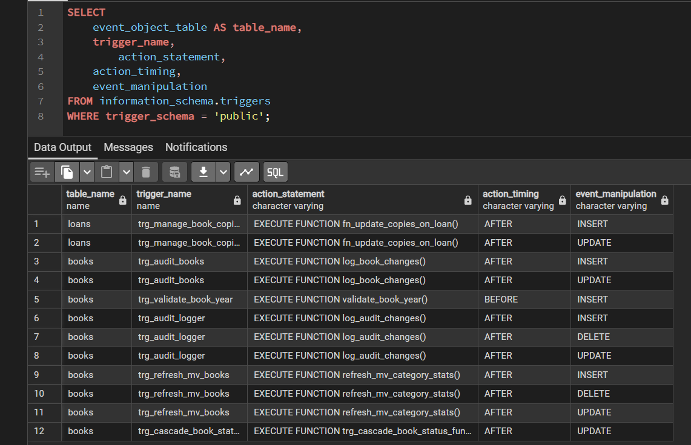 список усіх створених тригерів.

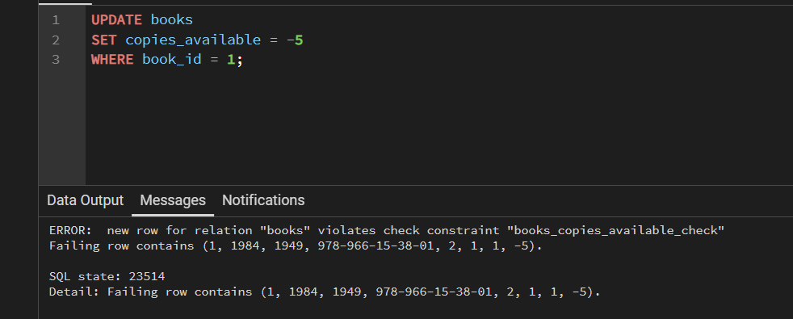 перевірка
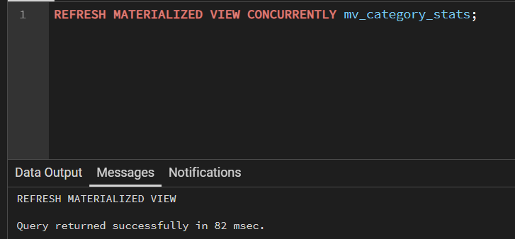

Документація системи прав доступу для різних ролей користувачів.

Для забезпечення безпеки, розмежування прав доступу та захисту конфіденційних даних у базі даних library_db реалізовано модель управління доступом на основі ролей (Role-Based Access Control - RBAC).
У системі створено три базові ролі та відповідні їм облікові записи користувачів із різним рівнем привілеїв:
А. Перелік ролей та рівні їх доступу
Роль: readonly (Користувач / Гість)
Обліковий запис: viewer
Рівень прав: Мінімальні привілеї (тільки читання).
Доступні операції: Дозвіл на виконання команди SELECT виключно до загальнодоступних таблиць та представлень (наприклад, перегляд списку книг, категорій та загальної наявності). Будь-які модифікації (INSERT, UPDATE, DELETE) заблоковані.
Роль: readwrite (Модератор / Бібліотекар)
Обліковий запис: moderator
Рівень прав: Розширені операційні привілеї.
Доступні операції: Дозвіл на читання та зміну даних (SELECT, INSERT, UPDATE) в основних робочих таблицях (books, loans тощо). Ця роль дозволяє додавати нові книги, оформлювати видачі та оновлювати статус або кількість примірників, але без прав на керування структурою бази чи системними користувачами.
Роль: admin (Адміністратор бази даних)
Обліковий запис: administrator
Рівень прав: Повний контроль (ALL PRIVILEGES).
Доступні операції: Повний доступ до всіх таблиць, представлень, функцій, тригерів та процедур обслуговування. Адміністратор має право створювати резервні копії, змінювати схему бази даних, керувати ролями та виконувати службову процедуру обслуговування maintain_database().
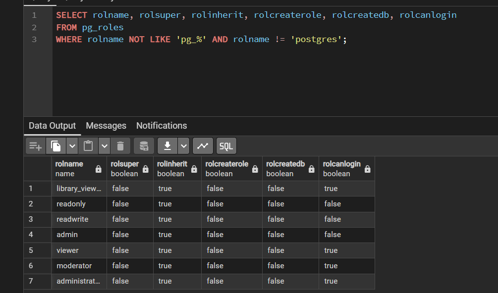 користувачі створені мною. Список чуть більший ніж я  створював тому що тут збереглися ролі ще з 4 лабораторної роботи.

Висновки щодо покращення продуктивності та рекомендації.
Під час виконання лабораторної роботи було проведено комплексне дослідження продуктивності, налаштування системних індексів, оптимізацію роботи тригерів, а також впровадження моделі контролю доступу (RBAC) для бази даних library_db у середовищі PostgreSQL 17.

А. Основні висновки:
Аналіз продуктивності (EXPLAIN ANALYZE): Дослідження планів виконання запитів показало, що на малих об'ємах даних планувальник PostgreSQL ефективно обирає послідовне сканування (Seq Scan) та хеш-з'єднання (Hash Join), забезпечуючи наднизький час виконання запитів (менше ніж 0.2 мілісекунди).

Оптимізація структури та індексування: Створення індексів для зовнішніх ключів (category_id) та ключових полів пошуку дозволяє гарантувати масштабованість системи при зростанні обсягу бібліотечного фонду та уникнути деградації продуктивності складних запитів.

Автоматизація та цілісність даних: Налаштовані обмеження (CHECK CONSTRAINT) та процедурні тригери забезпечують автоматичний контроль коректності даних (запобігання введенню від'ємних значень кількості примірників, валідацію років, ведення журналів аудиту), знімаючи це навантаження з прикладного програмного забезпечення.

Безпека та контроль доступу (RBAC): Розподіл прав за допомогою ролей (readonly, readwrite, admin) та персональних облікових записів забезпечив надійний захист інформації за принципом найменших привілеїв.

Б. Рекомендації щодо подальшого вдосконалення:
Моніторинг зростання таблиць: У міру збільшення кількості записів у таблицях books та loans рекомендується періодично перевіряти плани виконання запитів (EXPLAIN ANALYZE), щоб вчасно переходити від послідовного сканування до індексного пошуку (Index Scan).

Обслуговування БД: Налаштувати регулярне виконання команд ANALYZE та VACUUM для оновлення статистики планувальника та очищення мертвих рядків (dead tuples).

Оптимізація матеріалізованих представлень: Для аналітичних запитів використовувати періодичне фонове оновлення матеріалізованих представлень за допомогою команди REFRESH MATERIALIZED VIEW CONCURRENTLY, що дозволить уникнути блокування таблиць під час звітних періоді
